# Visual Outputs

## Original Image

The original image below was supplied for this run and used as the input for all 15 practicals. The scripts resize it to 256×256 before processing.

### 01. 3x3 Mean Filter
- **Test matrix center:** `22.2222` (`200 / 9`) · **Gaussian noise (σ = 0.05) PSNR:** `26.67 dB` → `27.23 dB`

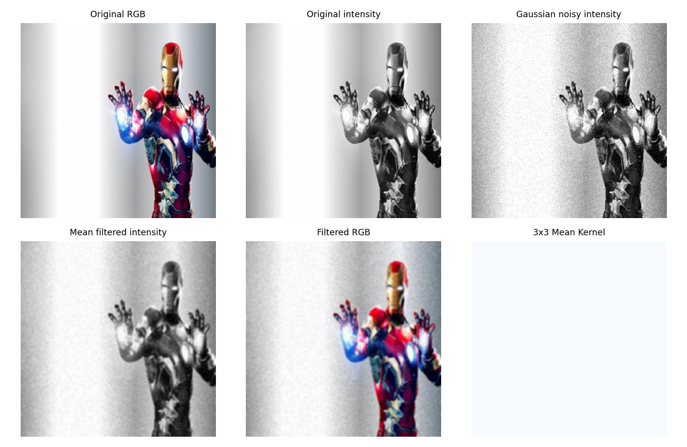

### 02. 3x3 Weighted Average Filter
- **Test matrix center:** `28.1250` (`450 / 16`) · **Gaussian noise (σ = 0.05) PSNR:** `26.67 dB` → `28.66 dB`

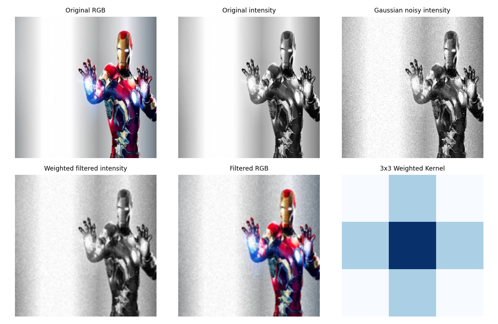

### 03. 5x5 Gaussian Spatial Filter (σ = 1.0)
- **5x5 Gaussian kernel sum:** `1.0` · **Gaussian noise (σ = 0.05) PSNR:** `26.67 dB` → `27.27 dB`

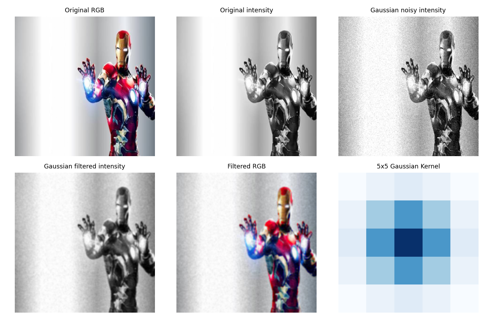

### 04. 3x3 Median Filter
- **Test matrix center:** `20.0000` · **Salt-and-pepper noise PSNR:** `17.36 dB` → `29.12 dB`

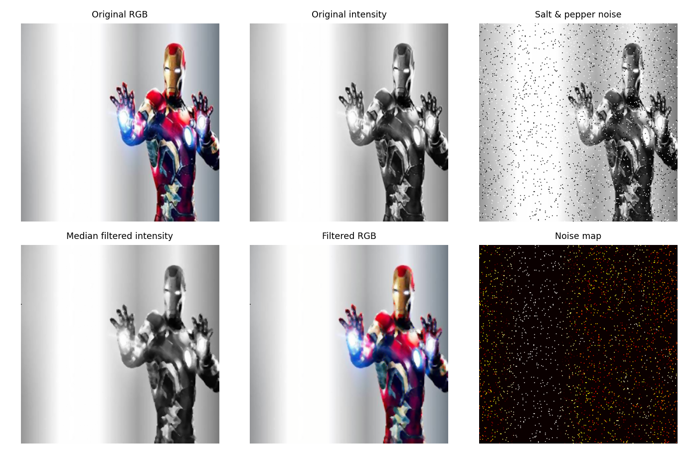

### 05. 3x3 Laplacian Sharpening Filter

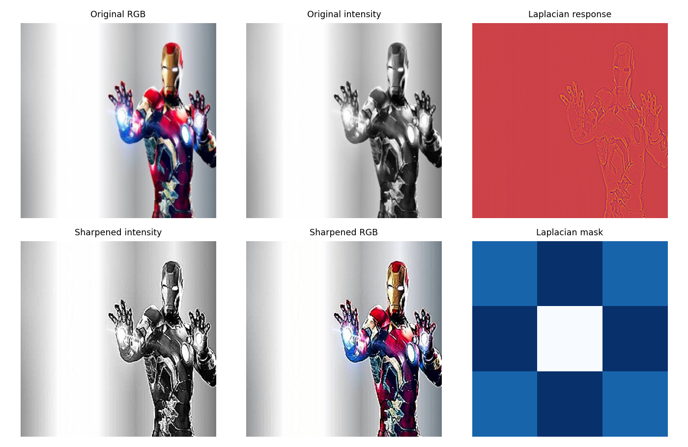

### 06. Sobel Edge Detection Filter

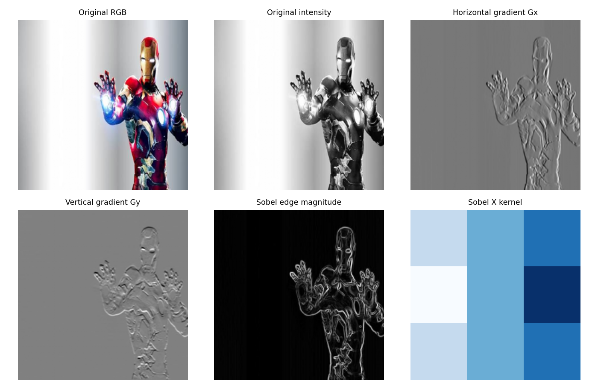

### 07. High-Boost Sharpening Filter (A = 1.5)

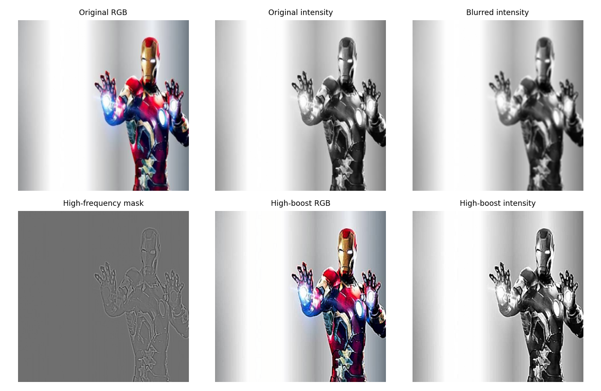

### 08. Ideal Low-Pass Filter (ILPF, D₀ = 40)

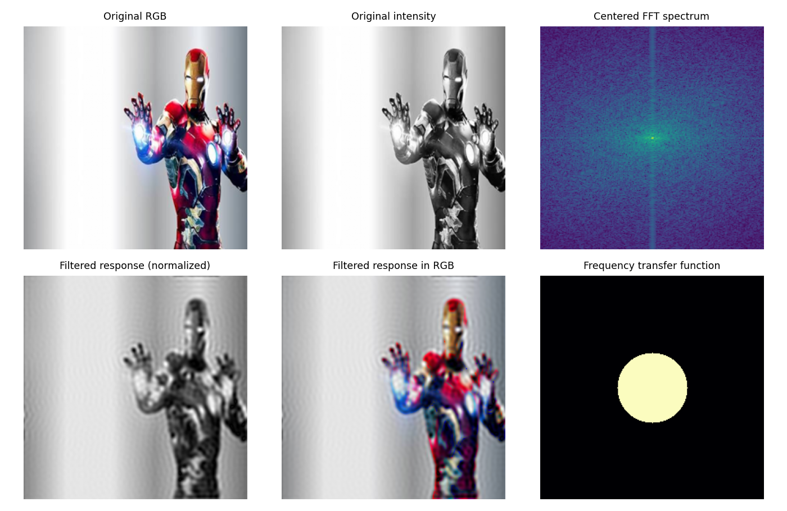

### 09. Butterworth Low-Pass Filter (BLPF, n = 2, D₀ = 40)

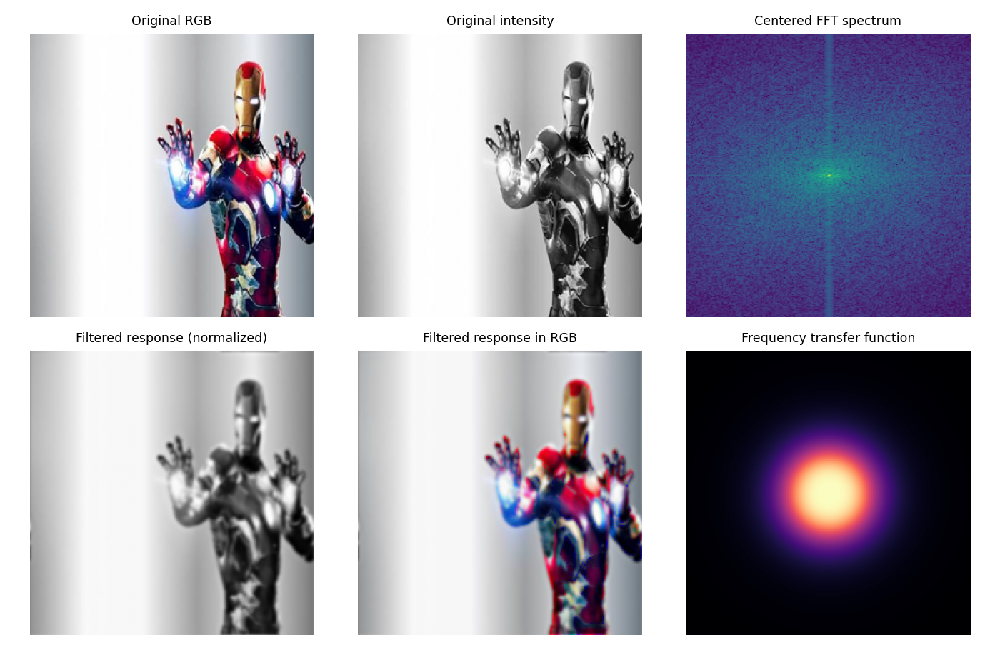

### 10. Gaussian Low-Pass Filter (GLPF, D₀ = 40)

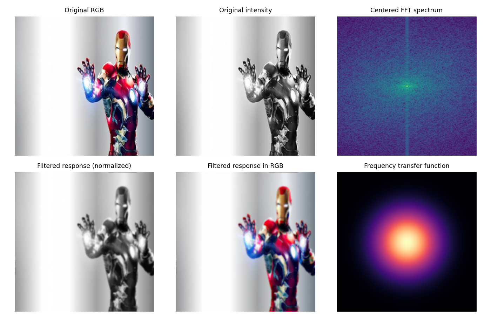

### 11. Ideal High-Pass Filter (IHPF, D₀ = 40)

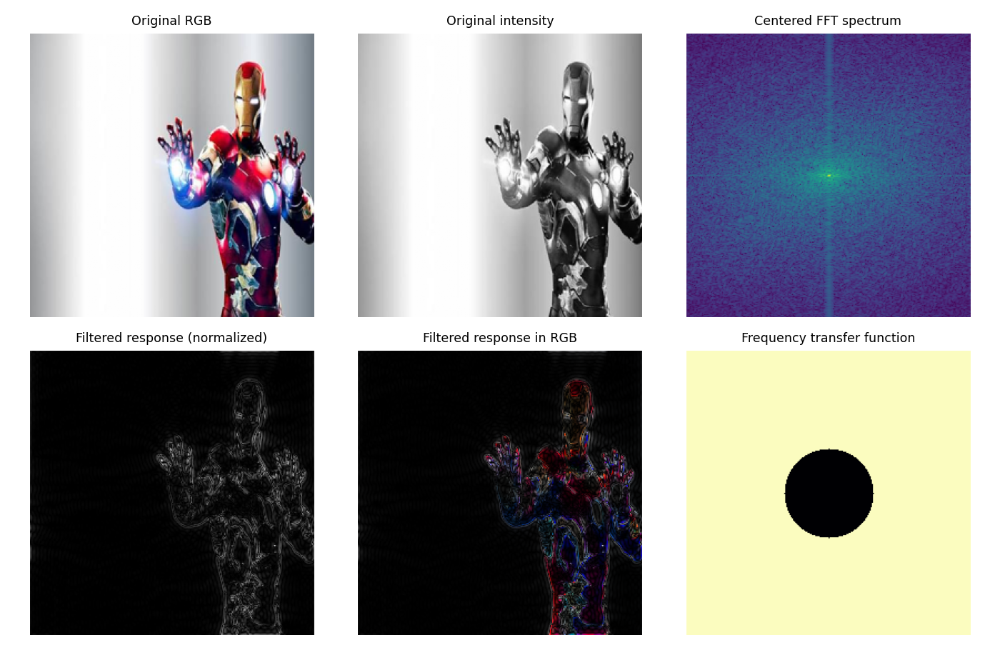

### 12. Butterworth High-Pass Filter (BHPF, n = 2, D₀ = 40)

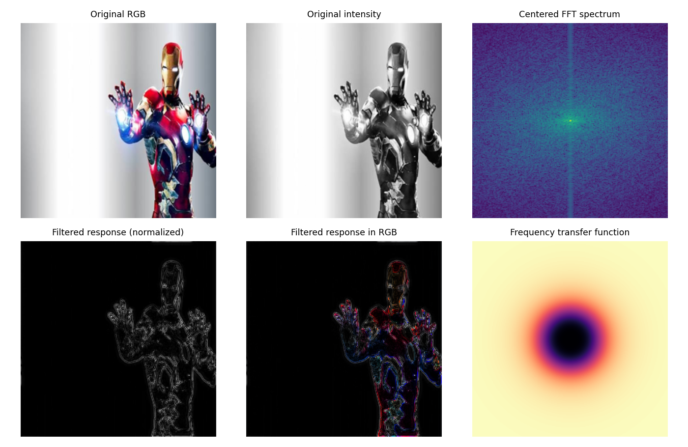

### 13. Gaussian High-Pass Filter (GHPF, D₀ = 40)

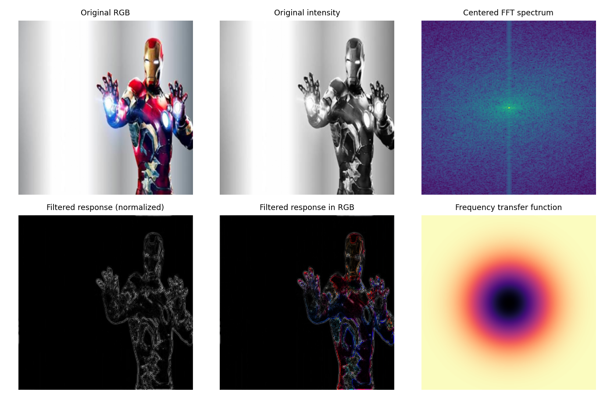

### 14. Huffman Coding (8-bit Grayscale)
- **Image (256×256):** `524,288` bits → `453,203` encoded bits (`1.157x`, lossless `True`)

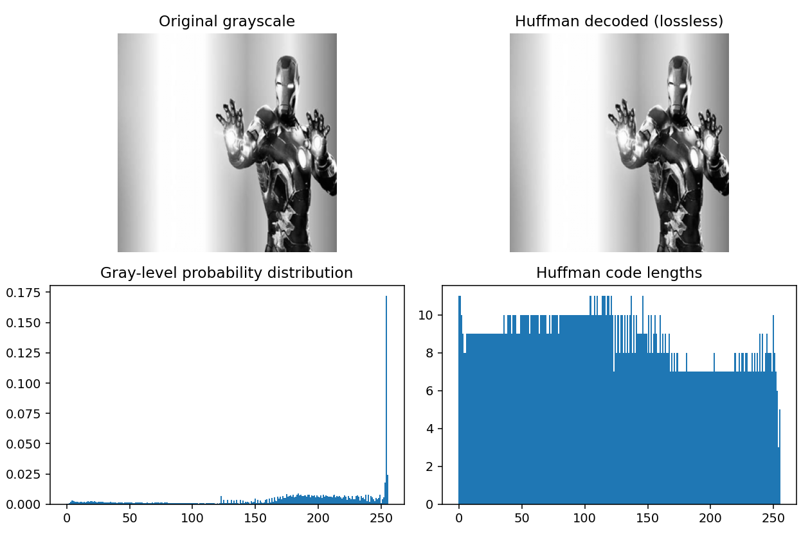

### 15. Arithmetic Coding (4-bit Quantized Grayscale)
- **Image (256×256):** `262,144` bits → `226,769` estimated encoded bits (`1.156x`, lossless `True`)

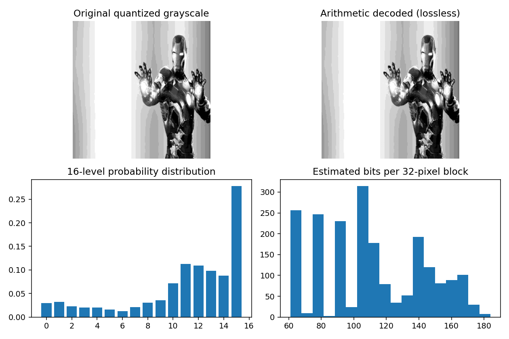
