# Digital Image Processing – Practical Outputs

## Original Image

The following original image was used as the input for the practical demonstrations.

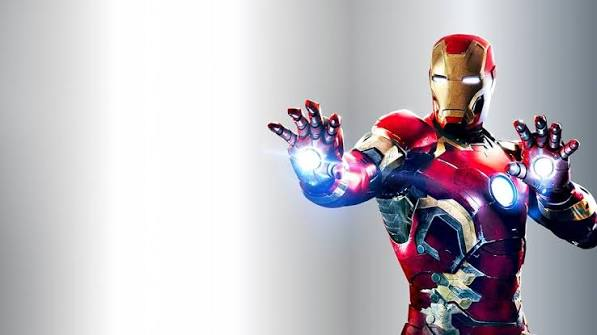

### 01. 3x3 Mean Filter

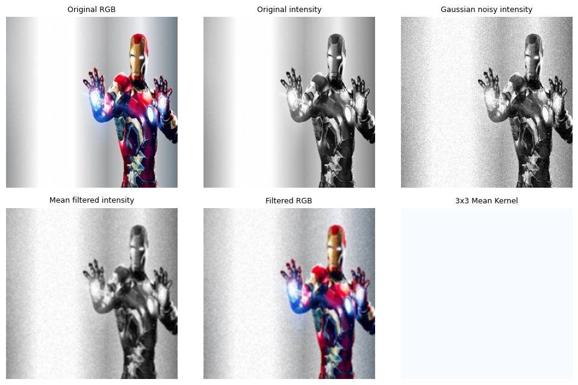

### 02. 3x3 Weighted Average Filter

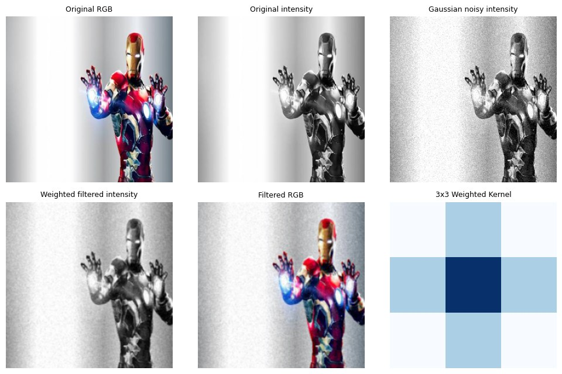

### 03. 5x5 Gaussian Spatial Filter

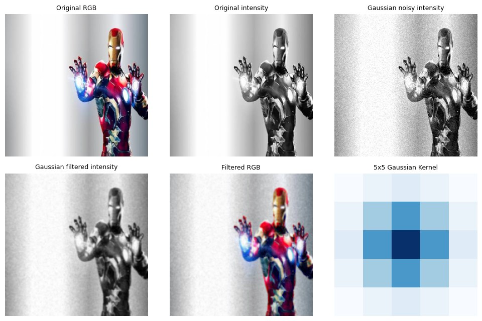

### 04. 3x3 Median Filter

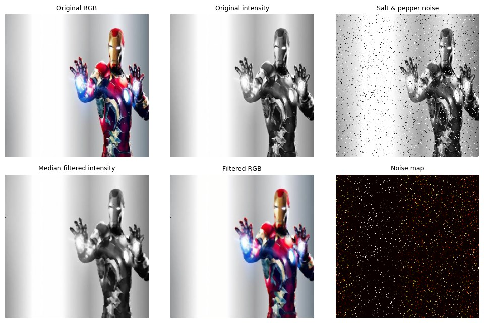

### 05. Laplacian Sharpening Filter

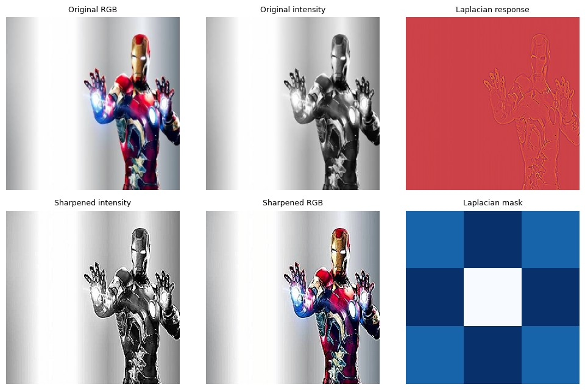

### 06. Sobel Edge Detection Filter

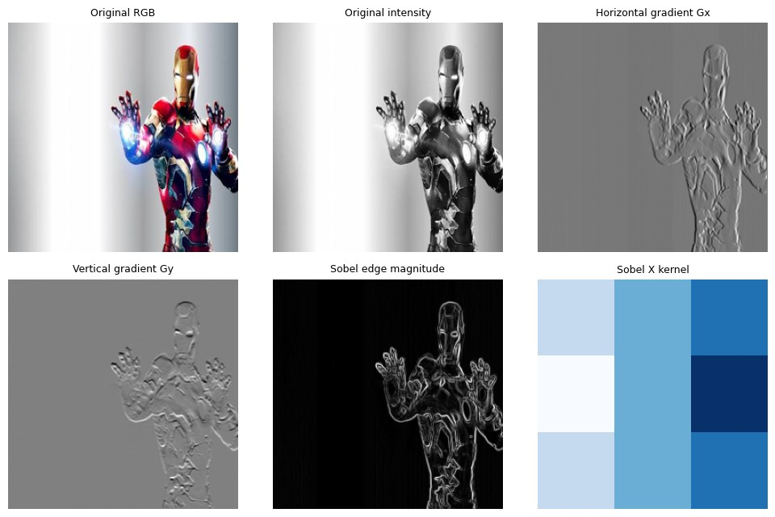

### 07. High-Boost Sharpening Filter

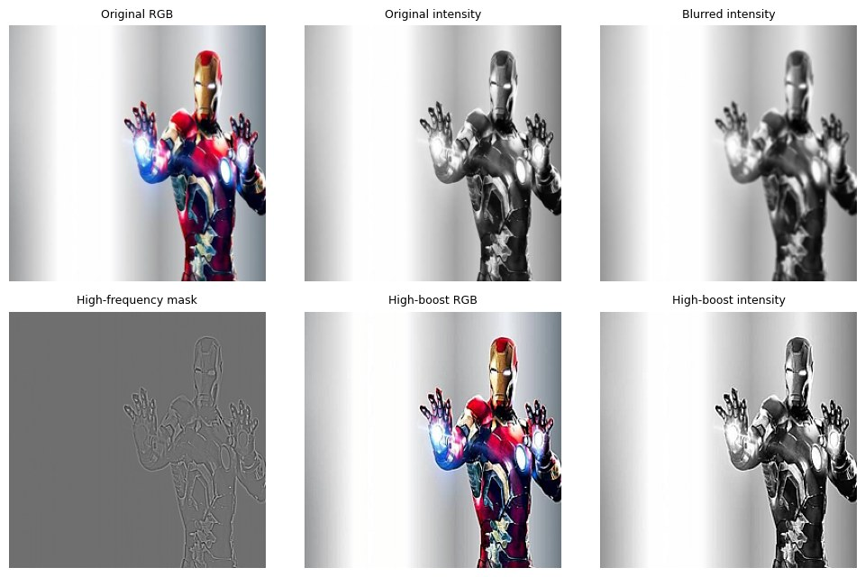

### 08. Ideal Low-Pass Filter

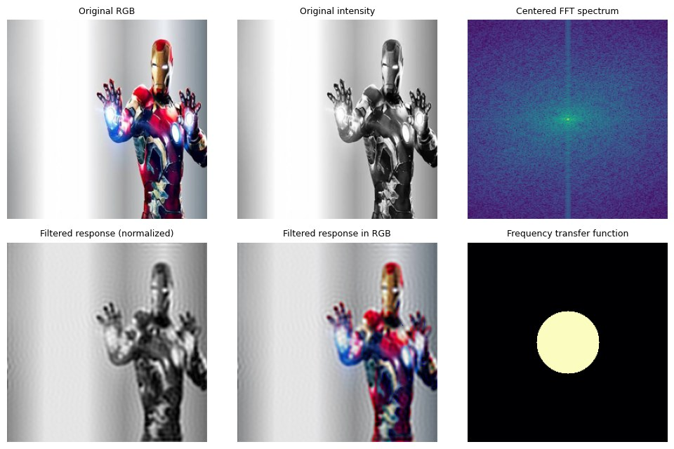

### 09. Butterworth Low-Pass Filter

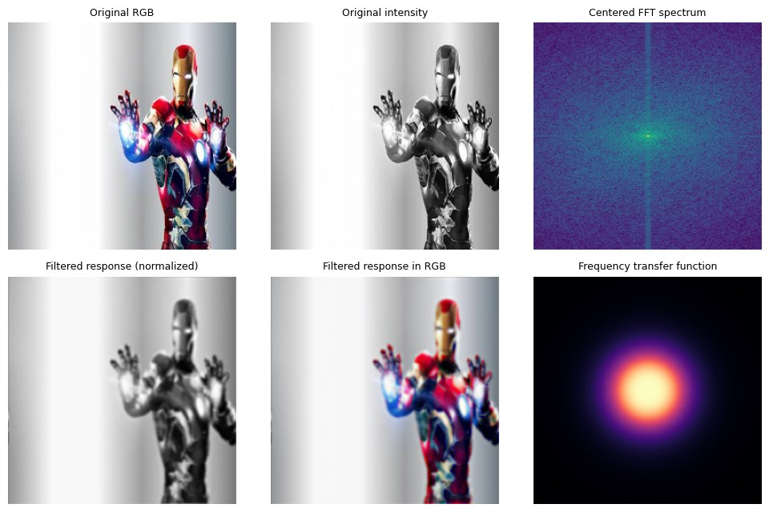

### 10. Gaussian Low-Pass Filter

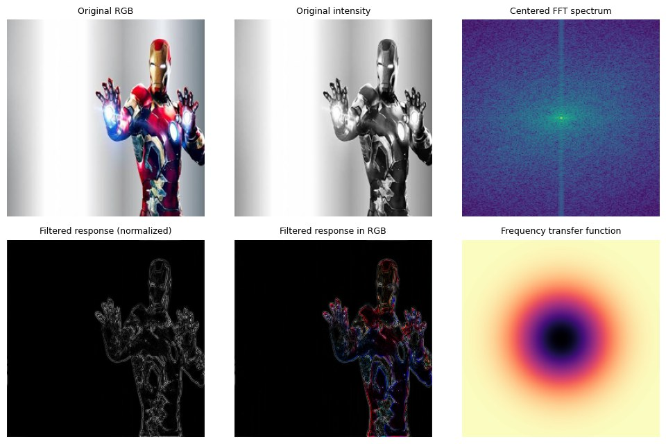

### 11. Ideal High-Pass Filter

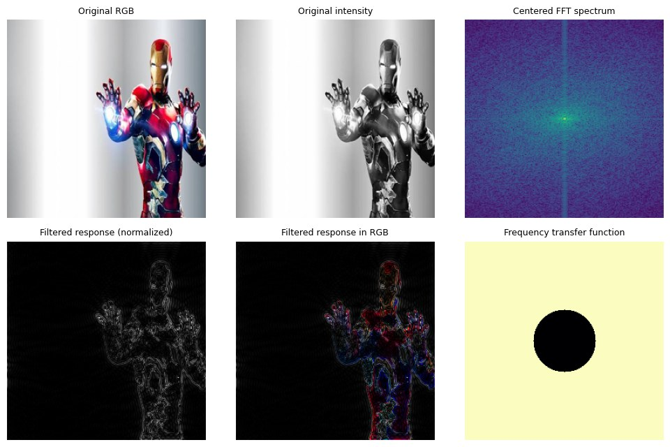

### 12. Butterworth High-Pass Filter

### 13. Gaussian High-Pass Filter

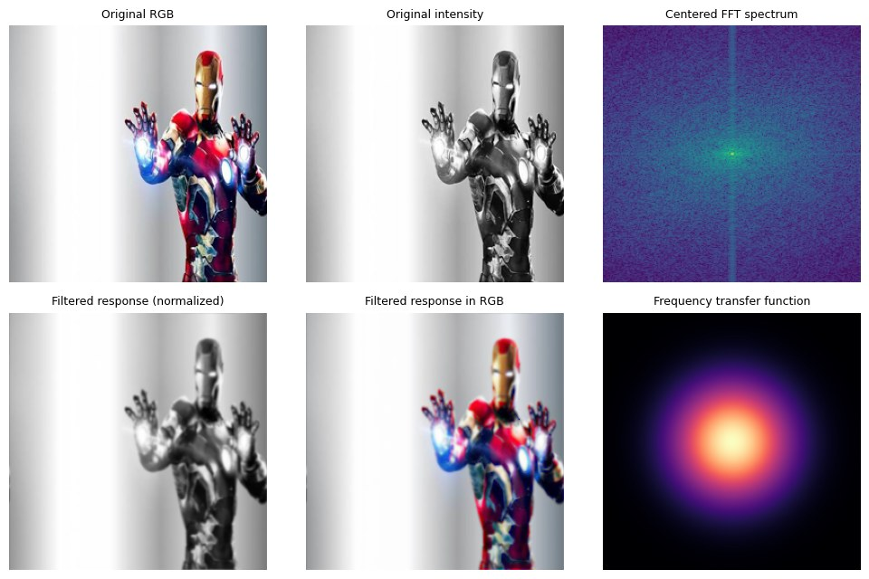

### 14. Huffman Coding

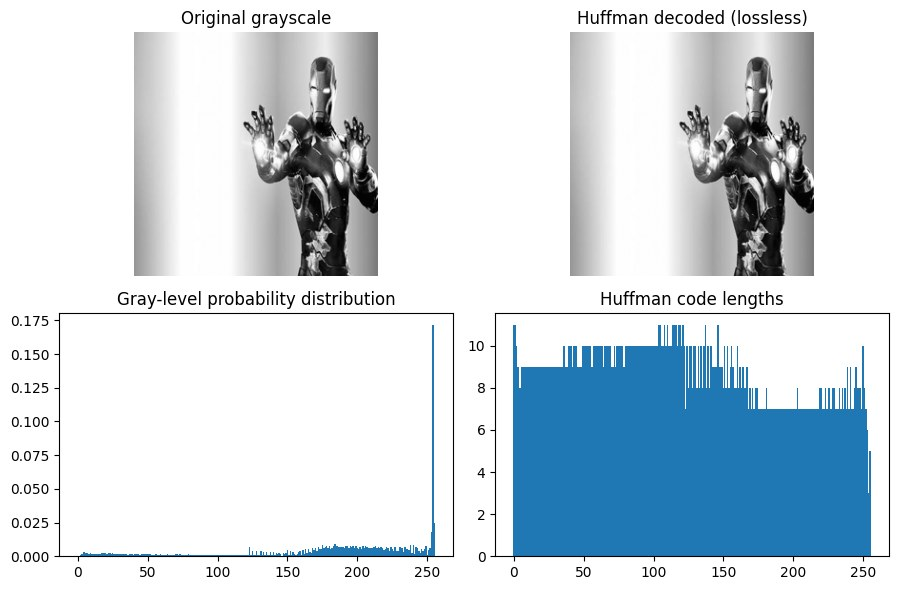

### 15. Arithmetic Coding

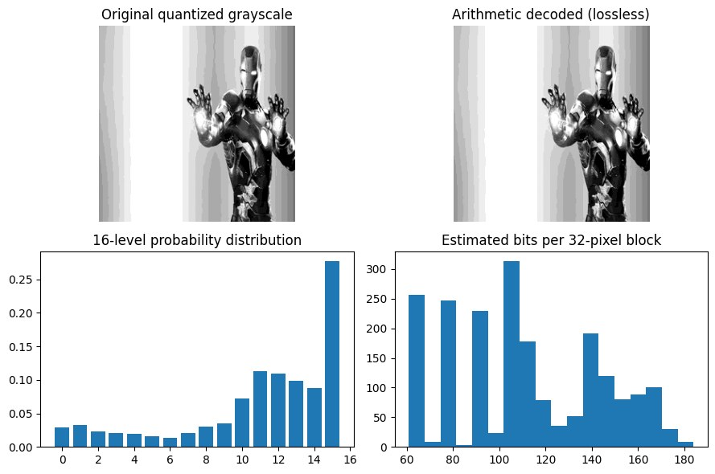

